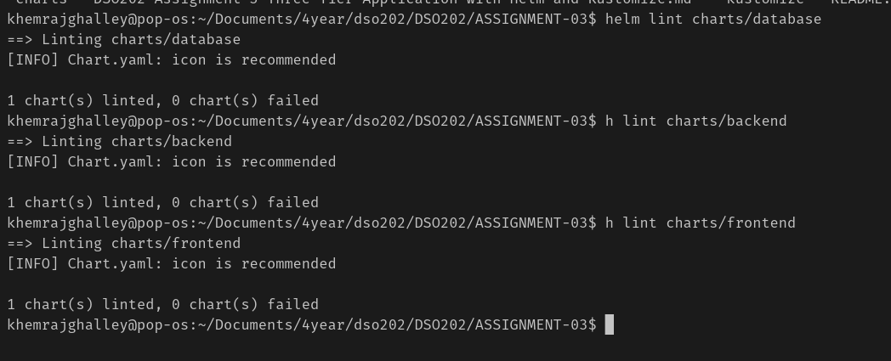
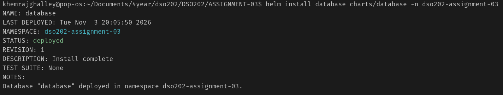
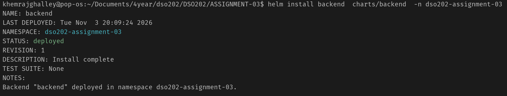
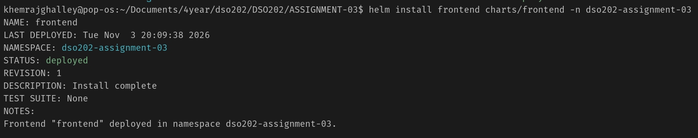
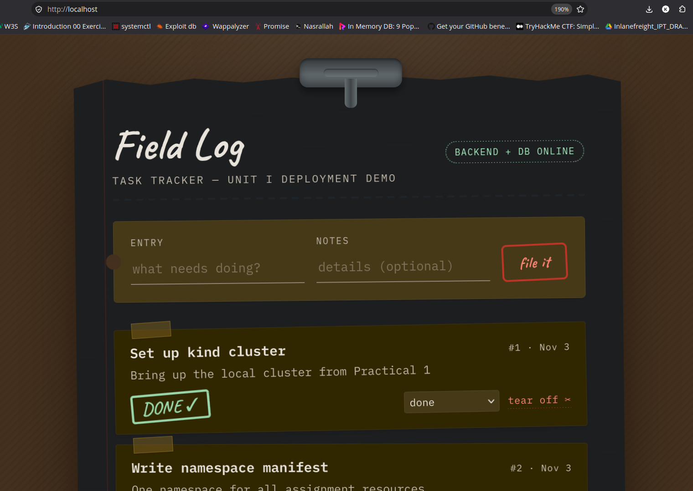

# DSO202 Assignment 3: Three-Tier Application with Helm and Kustomize


## Objectives and application overview

The three-tier application from Assignment 2 was packaged as three independent Helm charts, then layered with Kustomize to produce separate dev and prod environments. The application is exposed with `kubectl port-forward` instead of an Ingress.

**Objectives**

- Package each tier of the application as its own Helm chart.
- Install, upgrade and roll back each tier independently with Helm.
- Use Kustomize to customise the rendered charts per environment without editing the charts.
- Upgrade the application version with both tools and roll it back.

| Tier | Image | Kubernetes object | Service port | Container port |
| --- | --- | --- | --- | --- |
| Database | `rynorbu11/dso202-db:1.0` | StatefulSet + headless Service | 5432 | 5432 |
| Backend | `rynorbu11/dso202-backend:1.0` | Deployment + ClusterIP Service | 8080 | 8080 |
| Frontend | `rynorbu11/dso202-frontend:1.0` | Deployment + ClusterIP Service | 80 | 8080 |

The browser loads the frontend from `localhost:80` and calls the backend directly at `localhost:8080`. The backend reaches PostgreSQL inside the cluster through the `database` Service.

## Fundamentals of Helm

**Helm** is the package manager for Kubernetes. A chart contains:

- `Chart.yaml`: the chart's name, chart version and application version.
- `values.yaml`: default settings such as image tag, replicas and ports.
- `templates/`: Kubernetes manifests with placeholders filled from the values.

## Folder structure

Three charts are created, so each tier can be installed, upgraded and rolled back on its own. I this this is a best practice for multi-tier applications and production practies.

```
ASSIGNMENT-03/
├── charts/
│   ├── database/
│   │   ├── Chart.yaml
│   │   ├── values.yaml
│   │   └── templates/
│   │       ├── _helpers.tpl
│   │       ├── secret.yaml
│   │       ├── configmap.yaml
│   │       ├── service.yaml        # headless, port 5432
│   │       ├── statefulset.yaml
│   │       └── NOTES.txt
│   ├── backend/
│   │   ├── Chart.yaml
│   │   ├── values.yaml
│   │   └── templates/              # configmap, deployment, service (8080)
│   └── frontend/
│       ├── Chart.yaml
│       ├── values.yaml
│       └── templates/              # configmap, deployment, service (80 -> 8080)
└── kustomize/
    ├── base/                       # renders the 3 charts + namespace, quota, limitrange
    └── overlays/
        ├── dev/
        └── prod/
```

| Chart | Owns | Depends on |
| --- | --- | --- |
| database | `db-credentials` Secret, `database-config` ConfigMap, `database` Service, StatefulSet with a 1Gi PVC | nothing |
| backend | `backend-config` ConfigMap, `backend` Deployment and Service | `database` Service and `db-credentials` Secret |
| frontend | `frontend-config` ConfigMap, `frontend` Deployment and Service | backend reachable at `http://localhost:8080` from the browser |

Because of these dependencies the charts are installed in the order database, backend, frontend.

## Helm implementation

The Assignment 2 manifests were converted into templates, with every value that changes between installs moved into `values.yaml`.
The template for this assignment created from the Assignment 2 manifests.

### Creating the chart for every tier

```bash
helm create database
helm create backend
helm create frontend
```

For now I choose not to use the ingress as ingress concepts was implemented in assignment 2 Though it will be there by default. Instead, I will use port-forwarding to expose the application.

### Define the chart metadata

`Chart.yaml` records two separate versions: `version` is the version of the chart itself, and `appVersion` is the version of the application it deploys.

```yaml
apiVersion: v2
name: backend
description: Application tier - API Deployment for the DSO202 three-tier app
type: application
version: 0.1.0
appVersion: "1.0"
```

### Move configurable settings into values.yaml

Image, replicas, ports, configuration and resources come from values, so they can be changed at install time. Example from the backend chart:

```yaml
fullnameOverride: backend
image:
  repository: rynorbu11/dso202-backend
  tag: "1.0"
  pullPolicy: IfNotPresent
replicaCount: 1
containerPort: 8080
service:
  type: ClusterIP
  port: 8080
config:
  corsOrigin: "*"
database:
  host: database
  port: 5432
  name: app_db
  secretName: db-credentials
resources:
  requests: { cpu: 250m, memory: 256Mi }
  limits:   { cpu: 500m, memory: 512Mi }
```

`fullnameOverride` keeps the Service names fixed (`database`, `backend`, `frontend`), so the backend can always find the database at `DB_HOST=database`.

### Writing the templates

The templates read from `.Values`. Shared labels live in `_helpers.tpl` so every object in a chart is labelled the same way:

```yaml
{{- define "backend.labels" -}}
app.kubernetes.io/name: {{ include "backend.fullname" . }}
app.kubernetes.io/instance: {{ .Release.Name }}
app.kubernetes.io/managed-by: {{ .Release.Service }}
helm.sh/chart: {{ .Chart.Name }}-{{ .Chart.Version }}
tier: backend
{{- end -}}
```

The Deployment template pulls the image from values and adds a checksum of the ConfigMap. When the configuration changes, the checksum changes and the pods restart automatically:

```yaml
    metadata:
      annotations:
        checksum/config: {{ include (print $.Template.BasePath "/configmap.yaml") . | sha256sum }}
    spec:
      containers:
        - name: backend-api
          image: "{{ .Values.image.repository }}:{{ .Values.image.tag }}"
          envFrom:
            - configMapRef:
                name: {{ include "backend.fullname" . }}-config
```

Key design choices per tier:

- **Database:** a StatefulSet with `volumeClaimTemplates` for persistent storage and a headless Service (`clusterIP: None`) for a stable DNS name. The chart also creates the `db-credentials` Secret.
- **Backend:** reads `DB_USER` and `DB_PASSWORD` from the database chart's Secret and everything else from its own ConfigMap.
- **Frontend:** the Service listens on port 80 and forwards to container port 8080. `BACKEND_URL` is `http://localhost:8080`, because the browser reaches the backend through port-forwarding.

### Validating the charts

```bash
helm lint charts/database
helm lint charts/backend
helm lint charts/frontend
```



### Installing the charts in dependency order

```bash
helm install database charts/database -n dso202-assignment-03
```


```bash
helm install backend  charts/backend  -n dso202-assignment-03
```


```bash
helm install frontend charts/frontend -n dso202-assignment-03
```


### Verify the deployment

```bash
helm list -n dso202-assignment-03
kubectl get all,pvc -n dso202-assignment-03
```


All three releases show `deployed` at revision 1, the pods `database-0`, `backend-…` and `frontend-…` are `Running`, and the PVC `postgres-storage-database-0` is `Bound`.

*Evidence: screenshot of `helm list` and `kubectl get all,pvc`.*

## Exposing the application
Every tier is exposed using port-forwarding, instead of using an Ingress

### Port-forwarding

```bash
kubectl port-forward -n dso202-assignment-03 svc/database 5432:5432

kubectl port-forward -n dso202-assignment-03 svc/backend 8080:8080

kubectl port-forward -n dso202-assignment-03 svc/frontend 80:80
```
Every tier of application is exposed directly using the port-forwarding.

The frontend is opened at `http://localhost` and data was added through the UI. The browser's Network tab confirmed the requests went to `localhost:8080`.



## Kustomize implementation

Kustomize renders the three Helm charts as a shared base and produces a dev and a prod environment from it, without changing a single chart file.

Kustomize folder structure:
```
kustomize/
├── base/                       # renders the 3 charts + namespace, quota, limitrange
└── overlays/ 
    ├── dev/
    └── prod/
    └── staging/ (optional)
```

### Creating the base

`kustomize/base/kustomization.yaml` renders the charts with `helmCharts` and adds the namespace-level objects that belong to no single tier:

```yaml
apiVersion: kustomize.config.k8s.io/v1beta1
kind: Kustomization

namespace: dso202-assignment-03

resources:
  - namespace.yaml
  - resourcequota.yaml
  - limitrange.yaml

helmGlobals:
  chartHome: ../../charts

helmCharts:
  - name: database
    releaseName: database
    namespace: dso202-assignment-03
  - name: backend
    releaseName: backend
    namespace: dso202-assignment-03
  - name: frontend
    releaseName: frontend
    namespace: dso202-assignment-03

labels:
  - pairs:
      app.kubernetes.io/part-of: dso202-three-tier
```

### Create the overlays

It stays inside the base directory where we can do extra modification and override to the base. For now it is production.

Each overlay points at the base and changes only what differs for that environment.

| Setting | dev | prod |
| --- | --- | --- |
| Namespace | `dso202-dev` | `dso202-prod` |
| `env` label | dev | prod |
| Backend / frontend replicas | 1 / 1 | 2 / 2 |
| Database volume | 1Gi | 2Gi |
| Backend `CORS_ORIGIN` | `*` | `http://localhost` |
| Image tags | from chart | pinned with `images:` |

The prod overlay uses four Kustomize features: `namespace`, `replicas`, `images`, and JSON `patches`:

```yaml
apiVersion: kustomize.config.k8s.io/v1beta1
kind: Kustomization

namespace: dso202-prod
resources:
  - ../../base
labels:
  - pairs:
      env: prod

images:
  - name: rynorbu11/dso202-frontend
    newTag: "1.0"
  - name: rynorbu11/dso202-backend
    newTag: "1.0"
  - name: rynorbu11/dso202-db
    newTag: "1.0"

replicas:
  - name: backend
    count: 2
  - name: frontend
    count: 2

patches:
  - target: { kind: Namespace, name: dso202-assignment-03 }
    patch: |-
      - op: replace
        path: /metadata/name
        value: dso202-prod
  - target: { kind: ConfigMap, name: backend-config }
    patch: |-
      - op: replace
        path: /data/CORS_ORIGIN
        value: "http://localhost"
  - target: { kind: StatefulSet, name: database }
    patch: |-
      - op: replace
        path: /spec/volumeClaimTemplates/0/spec/resources/requests/storage
        value: 2Gi
```
<!-- 
### Build and compare the overlays

Because the base renders Helm charts, the build needs `--enable-helm`. The charts sit outside the `kustomize/` folder, so `--load-restrictor LoadRestrictionsNone` is also needed.

```bash
F="--enable-helm --load-restrictor LoadRestrictionsNone"
kustomize build $F kustomize/overlays/dev  > dev.yaml
kustomize build $F kustomize/overlays/prod > prod.yaml
diff dev.yaml prod.yaml
```

The diff shows only the namespace, label, replica, CORS and storage differences listed above.

*Evidence: screenshot of the diff.* -->

<!-- ### Apply and verify

```bash
kustomize build $F kustomize/overlays/dev  | kubectl apply -f -
kustomize build $F kustomize/overlays/prod | kubectl apply -f -

kubectl get pods -n dso202-dev     # 1 backend, 1 frontend, database-0
kubectl get pods -n dso202-prod    # 2 backend, 2 frontend, database-0
```

To open an environment in the browser, stop the earlier port-forwards (the local ports would clash) and forward from `dso202-dev` or `dso202-prod` instead.

*Evidence: screenshot of the pods in both namespaces.* -->

<!-- ## Practical: upgrading the application version with Kustomize

The dev frontend was upgraded to 1.1 by changing only the overlay's image tag, verified, and rolled back two ways. The chart and the prod overlay were not touched, so prod stayed on 1.0.

### Practical 1: Set the new image tag in the dev overlay

`kustomize edit` writes the `images:` entry into the overlay's `kustomization.yaml`:

```bash
cd kustomize/overlays/dev
kustomize edit set image rynorbu11/dso202-frontend=rynorbu11/dso202-frontend:1.1
cat kustomization.yaml
cd ../../..
```

The overlay now contains:

```yaml
images:
  - name: rynorbu11/dso202-frontend
    newName: rynorbu11/dso202-frontend
    newTag: "1.1"
```

### Practical 2: Preview the change against the cluster

`kubectl diff` shows exactly what will change in the running cluster before anything is applied:

```bash
F="--enable-helm --load-restrictor LoadRestrictionsNone"
kustomize build $F kustomize/overlays/dev | kubectl diff -f -
```

Only the frontend image line changes, from `1.0` to `1.1`.

*Evidence: screenshot of the diff output.*

### Practical 3: Apply and verify

```bash
kustomize build $F kustomize/overlays/dev | kubectl apply -f -
kubectl rollout status deploy/frontend -n dso202-dev
kubectl get deploy frontend -n dso202-dev \
  -o jsonpath='{.spec.template.spec.containers[0].image}{"\n"}'
kubectl get deploy frontend -n dso202-prod \
  -o jsonpath='{.spec.template.spec.containers[0].image}{"\n"}'
```

Dev reports `rynorbu11/dso202-frontend:1.1` while prod still reports `1.0`. This is the main benefit of overlays: one environment can be upgraded and tested before the next.

### Practical 4: Promote to prod

Once dev is confirmed working, change `newTag` for the frontend in `kustomize/overlays/prod/kustomization.yaml` from `"1.0"` to `"1.1"` and apply the prod overlay:

```bash
kustomize build $F kustomize/overlays/prod | kubectl apply -f -
kubectl rollout status deploy/frontend -n dso202-prod
```

### Practical 5: Roll back

Kustomize has no release history of its own, so there are two ways to roll back.

**Option A: declarative rollback (recommended).** Set the tag back and re-apply. The files stay the single source of truth.

```bash
cd kustomize/overlays/dev
kustomize edit set image rynorbu11/dso202-frontend=rynorbu11/dso202-frontend:1.0
cd ../../..
kustomize build $F kustomize/overlays/dev | kubectl apply -f -
```

When the overlays are kept in Git, `git revert` on the commit that changed the tag does the same thing and records why.

**Option B: quick rollback with kubectl.** Kubernetes keeps the Deployment's previous ReplicaSets, so it can undo directly:

```bash
kubectl rollout history deploy/frontend -n dso202-dev
kubectl rollout undo    deploy/frontend -n dso202-dev
```

This is fast in an emergency, but the overlay file still says 1.1. The next `kubectl apply` would upgrade again, so the file must be fixed afterwards.

*Evidence: screenshot of `kubectl rollout history` and the image back at 1.0.* -->

## Challenges

- At first, I didn't have the clear picture of the chart, I had a few questions on my mind:
  - Do I create a single chart for the whole application or one chart per tier?
  - How do I handle secrets and configmaps? Should they be in the same chart or separate?
After clearing these questions, I had a clear picture of the chart and started implementing it.
- understanding the go templating syntax was a bit challenging, but after watching youtube videos I was able to understand it.
- Its quite challenging to implement Kustomize on top of Helm charts, and I still couldn't understand how to use it properly. But I have a clear understanding of how it works alone. and still couldn't implement it on top of Helm charts. I will keep learning and try to implement it in the future.

## Helm vs Kustomize

|  | Helm | Kustomize |
| --- | --- | --- |
| Approach | Templates filled from values | Plain YAML changed by patches |
| Version history | Built-in revisions per release | None; relies on Git and Deployment history |
| Upgrade | `helm upgrade` with new values | Change the overlay, then `kubectl apply` |
| Rollback | `helm rollback <release> <revision>` | Revert the overlay, or `kubectl rollout undo` |
| Failed upgrade safety | `--atomic` rolls back automatically | Manual |
| Multiple environments | Separate values files | Overlays per environment |
| Best at | Packaging and releasing an application | Environment-specific customisation |

## Conclusion

Splitting the application into three Helm charts made each tier independently installable, upgradable and reversible, as shown by upgrading the frontend to 1.1 and rolling it back without touching the database or backend. Layering Kustomize on the same charts gave dev and prod environments with different replicas, storage, CORS and image tags from one set of templates. Together they show the common pattern of Helm for packaging and Kustomize for per-environment configuration.

